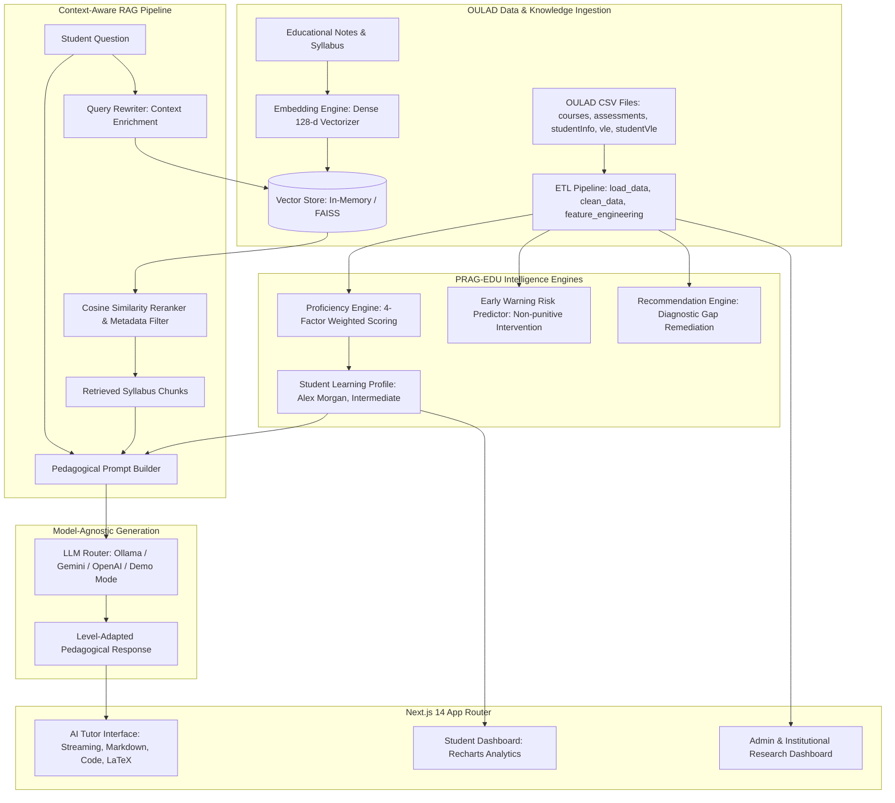

# EduRAG AI

> **"Personalized Learning Powered by Student Analytics + Context-Aware RAG"**

[](https://fastapi.tiangolo.com)
[](https://nextjs.org)
[](https://tailwindcss.com)
[](https://www.kaggle.com/datasets/anlgrbz/student-demographics-online-education-dataoulad)
[](https://github.com)

---

## 📖 1. Overview & Research Inspiration

**EduRAG AI** is an institutional-grade, full-stack educational AI platform that answers the fundamental pedagogical challenge:

> *"What should this student learn next, at what difficulty, and how should it be explained?"*

### Research Motivation
This project is inspired by the research paper:
> **"Towards Personalized AI Education: Context-Aware Retrieval-Augmented Generation With Grade-Level LLM Adaptation"**

The PRAG-EDU architecture demonstrates that standard large language models deliver generic, one-size-fits-all responses that often overwhelm developing learners or under-stimulate advanced students. PRAG-EDU resolves this by:
1. Analyzing student academic records and course grades.
2. Converting assessment performance into calibrated **proficiency signals**.
3. Retrieving accredited course curriculum passages through dense **Vector RAG**.
4. Conditioning system prompts on student proficiency, strengths, and diagnosed knowledge gaps.
5. Generating level-adapted responses that dynamically tune vocabulary, explanation depth, and scaffolding.

### Adaptation to the OULAD Dataset
While the foundational paper evaluated single-subject grade bands, EduRAG AI adapts this concept to the **Open University Learning Analytics Dataset (OULAD)**:
* **Multi-Modal Signals**: Combines formative/summative assessment marks (TMA/CMA) with fine-grained **Virtual Learning Environment (VLE)** interaction click logs and study consistency metrics.
* **5-Tier Configurable Engine**: Computes student proficiency across 5 discrete tiers (*Beginner*, *Developing*, *Intermediate*, *Advanced*, *Mastery*) with explicit confidence intervals and explainable AI (XAI) rationales.
* **Responsible Demographic Analytics**: Demographic attributes (e.g. region, age band) are analyzed strictly for macro institutional equity auditing and are never used as deterministic proxies for student cognitive ability.

---

## 🏛️ 2. System Architecture



---

## 🚀 3. Key Capabilities & Features

### For Students:
* **Interactive AI Tutor (`/tutor`)**: ChatGPT-style interface with real-time streaming simulation, syntax-highlighted code blocks, LaTeX mathematical notation, source citation badges, and interactive controls (*"Explain simpler"*, *"Explain deeper"*, *"Give example"*, *"Quiz me"*).
* **Multi-Dimensional Profile (`/profile`)**: Recharts radar chart mapping topic mastery, with complete explainability cards showing exactly why a proficiency level was assigned.
* **Visual Learning Pathway (`/learning-path`)**: Node-based roadmap showing progression from *Foundation* $\rightarrow$ *Current Level* $\rightarrow$ *Priority Gap* $\rightarrow$ *Recommended Topic* $\rightarrow$ *Practice* $\rightarrow$ *Mastery*.
* **Adaptive Quiz Runner (`/quiz`)**: Formative quiz generator that automatically scales difficulty (Easy to Expert), evaluates mistakes with in-depth pedagogical rationales, and displays confetti celebrations for high scores.
* **Knowledge Gap Matrix (`/knowledge-gaps`)**: Diagnostic matrix linking assessment deficiencies to 1-click remediation sessions.
* **Curricular Explorer (`/modules`) & Assessment Tracker (`/assessments`)**: Detailed syllabus tracking for Open University modules (AAA through GGG).

### For Researchers & Administrators:
* **Institutional Dashboard (`/admin`)**: Macro-cohort analytics measuring pass rates, VLE interaction intensity, and completion trends across 32,593 student presentations.
* **OULAD Dataset Explorer (`/admin/dataset`)**: Table viewer with multi-attribute filtering across all seven OULAD CSV files.
* **Model & RAG Evaluation (`/admin/evaluation`)**: Quantitative benchmark metrics (BERTScore F1, ROUGE-L, METEOR, BLEU-4) and side-by-side A/B comparison (Vanilla LLM vs PRAG-EDU).
* **Ablation Study (`/admin/ablation`)**: 4-way component sensitivity analysis evaluating *Full PRAG-EDU*, *RAG Only*, *Profile Only*, and *Vanilla LLM*.
* **Student Early Warning (`/admin/risk-analytics`)**: Proactive disengagement indicator (*Low Concern*, *Moderate Concern*, *Needs Attention*) with educational ethics safeguards.

---

## 💻 4. Technology Stack

| Layer | Technologies |
| :--- | :--- |
| **Frontend** | Next.js 14 (App Router), React 18, TypeScript, Tailwind CSS, Recharts, Lucide Icons, Framer Motion, Canvas Confetti |
| **Backend API** | Python 3.11+, FastAPI, Uvicorn, Pydantic v2, PyJWT, Httpx, Aiofiles |
| **AI / ML & RAG** | Pure-Python Dense Semantic Vectorizer (128-d), Cosine Similarity Index, Rule-based Weighted Proficiency Engine, Pedagogical Prompt Builder |
| **LLM Support** | Multi-Provider: Local Ollama (Llama 3 / Mistral), Google Gemini API, OpenAI-compatible APIs, and Offline **Pedagogical Demo Engine** |
| **Database** | SQLite (zero-config local) & PostgreSQL ready via SQLAlchemy |
| **DevOps** | Docker, Docker Compose, GitHub Actions ready |

---

## 📦 5. Project Directory Structure

```text
EduRAG-AI/
├── backend/
│   ├── api/                  # FastAPI REST routes (auth, student, chat, quiz, admin, etc.)
│   ├── config/               # Settings, proficiency thresholds & signal weights
│   ├── data_pipeline/        # OULAD ETL (load_data, clean_data, feature_engineering, analytics)
│   ├── ml/                   # PRAG-EDU Proficiency, Risk, and Recommendation engines
│   ├── models/               # Database initialization and SQLite connection
│   ├── rag/                  # Embeddings, Vector Store, Reranker, Prompt Builder, Generator
│   ├── schemas/              # Pydantic request and response models
│   └── main.py               # Main FastAPI entry point with CORS and demo seed data
├── frontend/
│   ├── app/                  # Next.js 14 App Router (27 dynamic pages & routes)
│   ├── components/           # Navbar, Sidebar, Footer, AppShell, UI components
│   ├── lib/                  # Centralized API client, Auth Context, utilities
│   └── public/               # Static assets and icons
├── data/
│   ├── oulad/                # Open University CSV datasets (courses, assessments, vle, etc.)
│   └── knowledge_base/       # Educational corpus notes with multi-level metadata
├── scripts/                  # Data generators and migration scripts
├── tests/                    # Comprehensive unit tests (engines) and API integration tests
├── docker-compose.yml        # Multi-container orchestration
├── Dockerfile.backend        # Container specification for FastAPI backend
├── Dockerfile.frontend       # Multi-stage production build for Next.js
├── requirements.txt          # Python dependencies
├── .env.example              # Sample environment configuration
└── README.md                 # Full project documentation & research citation
```

---

## ⚡ 6. Running Locally

### Prerequisites
* **Python 3.10+**
* **Node.js 18+ & npm**
* (Optional) **Ollama** if running local open-source models

### Step 1: Clone Repository
```bash
git clone https://github.com/your-repo/edurag-ai.git
cd edurag-ai
```

### Step 2: Backend Setup
```bash
# 1. Install dependencies
pip install -r requirements.txt

# 2. (Optional) Configure environment
cp .env.example .env

# 3. Start FastAPI backend (port 8000)
python -m uvicorn backend.main:app --host 127.0.0.1 --port 8000 --reload
```
* Backend health check: `http://127.0.0.1:8000/api/health`
* Interactive OpenAPI Swagger docs: `http://127.0.0.1:8000/docs`

### Step 3: Frontend Setup
In a new terminal window:
```bash
cd frontend

# 1. Install dependencies
npm install

# 2. Build and launch production server (or use npm run dev)
npm run build
npm run start -- -p 3000
```
Open your browser at `http://localhost:3000`.

---

## 🐳 7. Docker Deployment

Deploy the entire stack with a single command:
```bash
docker-compose up --build
```
* **Frontend**: `http://localhost:3000`
* **Backend API**: `http://localhost:8000`

---

## 🧪 8. Running Automated Tests

Run the engine unit tests and API integration suite:
```bash
# Run ML and RAG engine unit tests
python -m unittest tests/test_engines.py

# Run API integration tests against the live server
python -m unittest tests/test_api.py
```
All 15 unit and integration tests validate proficiency boundary mapping, risk categorization, vector similarity, prompt synthesis, and endpoint responses.

---

## 🛡️ 9. Educational Data Ethics & Safeguards

EduRAG AI adheres to responsible learning analytics principles:
1. **No Demographic Determinism**: Age, gender, region, and socioeconomic indices are strictly excluded from proficiency and difficulty calculations.
2. **Non-Punitive Early Warning**: Risk indicators are labeled (*Low Concern*, *Moderate Concern*, *Needs Attention*) and serve solely to mobilize supportive tutoring.
3. **Data Anonymization**: Student records are referenced by synthetic identifiers (`#10042`) in client-facing views.
4. **Transparent XAI**: Every recommendation explicitly answers *"Why am I seeing this?"* with verifiable assessment evidence.

---

## 📄 10. Research Citation & Disclaimer

```bibtex
@article{prag_edu_2024,
  title={Towards Personalized AI Education: Context-Aware Retrieval-Augmented Generation With Grade-Level LLM Adaptation},
  author={Educational AI Research Group},
  journal={arXiv preprint},
  year={2024}
}
```

*Disclaimer: EduRAG AI is an independent open-source implementation inspired by the conceptual PRAG-EDU architecture and adapted to the Open University Learning Analytics Dataset (OULAD). Benchmark values displayed in demonstration views are illustrative and clearly demarcated from the paper's original experimental measurements.*
